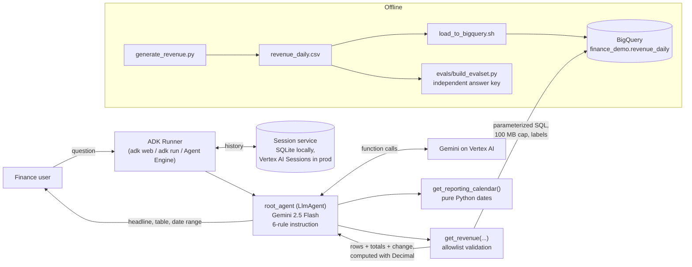

# Revenue Agent: governed finance Q&A on Gemini, ADK, and BigQuery

A finance-team assistant built with Google's
[Agent Development Kit](https://google.github.io/adk-docs/) (ADK 2.11) and
Gemini 2.5 Flash on Vertex AI. People ask questions in plain English ("How did
West do last quarter versus the same quarter last year?") and get answers from
a BigQuery warehouse, **without the model ever writing SQL**.

## The problem

"Chat with your data" demos usually let the model write SQL. For finance that
is a non-starter:

- **Wrong numbers are worse than no numbers.** A model that sums a column
  itself, or guesses what "last quarter" means, will sometimes be confidently
  wrong. This agent's own history shows it: an early version reported a
  quarterly total of $8,180,691 when the real figure was $8,180,591.
- **Governance.** Finance and security teams need to know exactly which
  queries can run, against which tables, at what cost.
- **Scope.** A revenue assistant should not hand out customer-level data,
  make forecasts, or try to edit the warehouse.

## The approach: approved tools

Engineering owns the query; business users own the questions.

- The model can call exactly two tools. `get_revenue` accepts a **grouping
  key** and **filter values** from fixed allowlists. Each key maps to a SQL
  expression written in code, and filter values are passed as BigQuery query
  parameters, so nothing the model writes is ever spliced into SQL.
- `get_reporting_calendar` turns "last quarter", "year to date", or
  "trailing 12 months" into exact dates, so the model never does date math.
- The tool computes totals and period-over-period changes in Python with
  `Decimal`, and the prompt forbids arithmetic. The model's job is to pick
  the right call and present the numbers it gets back.
- Every query has a 100 MB billing cap and cost-attribution labels.

## Architecture



A typical question takes three model calls: calendar → `get_revenue` → final
answer. A walkthrough of one query, with file and line references, is in
[WALKTHROUGH.md](WALKTHROUGH.md).

## Repo layout

```
generate_revenue.py              synthetic data (31,813 rows, fixed seed)
load_to_bigquery.sh              creates the dataset and loads the CSV
revenue_daily.csv                the data, committed so evals can run without BigQuery
revenue_agent/
  revenue_agent/                 the ADK agent package (what gets deployed)
    agent.py                     tools, guardrails, root_agent
    requirements.txt             pinned runtime dependencies
    .env.example                 config template
    .agent_engine_config.json    Agent Engine sizing (min 0, 1 vCPU / 2 GiB)
  evals/                         ADK eval set, config, custom metrics, report script
  test_tool.py                   tool tests against BigQuery, no LLM
requirements-dev.txt             adds ADK's eval extras
requirements-lock.txt            full pinned environment
NOTES.md  EVALS.md  DEPLOY.md  WALKTHROUGH.md  DECISIONS.md  CONCEPTS.md
```

## Setup

Prerequisites: Python 3.12, the `gcloud` CLI, a Google Cloud project with
billing, and Vertex AI + BigQuery enabled.

Create the virtual environment:
```bash
python3.12 -m venv .venv
```

Install runtime and eval dependencies:
```bash
.venv/bin/pip install -r requirements-dev.txt
```

Sign in for Application Default Credentials:
```bash
gcloud auth application-default login
```

Create your config, then set `GOOGLE_CLOUD_PROJECT` in it:
```bash
cp revenue_agent/revenue_agent/.env.example revenue_agent/revenue_agent/.env
```

Load the sample data into BigQuery (it reads the project from `.env`):
```bash
bash load_to_bigquery.sh
```

## Run it

Chat UI at http://localhost:8000:
```bash
cd revenue_agent && ../.venv/bin/adk web --port 8000 .
```

One question from the terminal:
```bash
cd revenue_agent && ../.venv/bin/adk run revenue_agent "What was revenue by region last quarter?"
```

Tool tests, no LLM (needs BigQuery):
```bash
cd revenue_agent && ../.venv/bin/python test_tool.py
```

## Evals

20 cases (21 turns) in `revenue_agent/evals/`, run with ADK's own
`adk eval`. They cover lookups, comparisons, trends, filters, relative dates,
a multi-turn follow-up, and six out-of-scope or invalid requests. **The
answer key is computed straight from the CSV by separate code**, not by
calling the agent's tool, so a bug in `get_revenue` would show up as a failure.

| Metric | Type | Checks |
|---|---|---|
| `tool_args_match` | custom, deterministic | Expected tool calls happened in order with the right arguments |
| `required_figures` | custom, deterministic | Every figure in the answer key appears in the answer |
| `grounded_figures` | custom, deterministic | Every $, %, or unit figure in the answer traces to a tool result |
| `rubric_based_final_response_quality_v1` | ADK built-in, LLM judge | Per-case behavior (refuses edits, states the date range, …) |

Run the evals:
```bash
cd revenue_agent && PYTHONPATH=. ../.venv/bin/adk eval revenue_agent evals/revenue_agent.evalset.json --config_file_path evals/test_config.json
```

Summarize the latest run:
```bash
cd revenue_agent && ../.venv/bin/python evals/summarize.py
```

### Results (2026-10-26, one run each)

| | Baseline | After fixes |
|---|---|---|
| Cases passing every metric | 19 / 20 | 19 / 20 |
| Tool calls correct | 19 / 20 | 20 / 20 |
| Every figure grounded in a tool result | 19 / 20 | 20 / 20 |
| Required figures present | 19 / 20 | 19 / 20 |
| LLM-judge rubrics | not scored | 20 / 20 |
| Median latency per turn | 7.7 s | 8.9 s |

The baseline failure was "year to date": the calendar tool had no such
period, so the agent gave up. It's fixed. The after-run failure is a correct
but less complete answer that passed in the baseline, so it's run-to-run
variance. Details and the open follow-up are in [EVALS.md](EVALS.md).

## Production considerations

**Auth and access**
- Run as a dedicated service account with `bigquery.jobUser` on the project
  and `bigquery.dataViewer` on **one dataset**, not project-wide roles (see
  [DEPLOY.md](DEPLOY.md)).
- The agent sees the whole table today. For per-user access (for example,
  regional managers see only their region), add BigQuery row-level security,
  or pass the caller's identity into the tool and add a filter that the model
  cannot override.
- The read-only guarantee comes from IAM, not the prompt: the runtime
  account cannot write to BigQuery even if the model asked it to.

**Observability**
- `adk deploy ... --trace_to_cloud` sends one trace per question to Cloud
  Trace, showing each model call and tool call with timings.
- BigQuery jobs carry `app=revenue-agent, tool=get-revenue` labels, so
  `INFORMATION_SCHEMA.JOBS` gives per-tool query counts, bytes, and cost.
- Track the eval pass rate on every change; gate deploys on it.
- Worth adding: an `after_tool_callback` that logs each tool's arguments and
  status, and alerts on `status: error` spikes (users asking for things the
  tool does not support).

**Cost**
- About 3 Gemini Flash calls and 1–2 small BigQuery queries per question:
  roughly half a cent per question. 1,000 questions/month is about $8 on
  Agent Engine with scale-to-zero.
- The biggest cost risk is Agent Engine's **default sizing** (4 vCPU, 1
  always-on instance, about $250–320/month idle). The included
  `.agent_engine_config.json` scales to zero on 1 vCPU / 2 GiB.
- `maximum_bytes_billed` caps every query at 100 MB, so a bad query fails
  instead of costing money.

**Known limits** (details in [DECISIONS.md](DECISIONS.md))
- The data window (`DATA_START`/`DATA_END`) is hard-coded for the demo
  dataset; production should read it from the table.
- Allowlists are repeated in the code, the tool docstring, and the prompt.
- Relative periods are anchored to the end of the data, which suits a static
  demo dataset but would be wrong for a live warehouse after year end.
