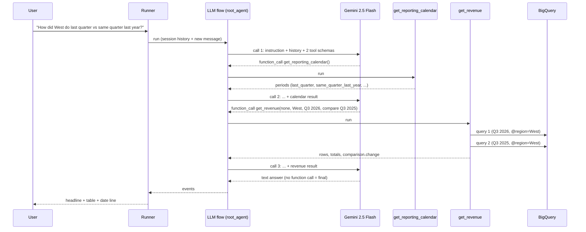

# Walkthrough: one question, end to end

The question:

> **How did the West region do last quarter compared to the same quarter last year?**

Everything below is from a real run: the `west_yoy` case in the after-fix
eval on 2026-10-26. It took **3 model calls, 2 tool calls, 5,604 tokens, and
12.4 s**.

Path conventions:
- `agent.py` = `revenue_agent/revenue_agent/agent.py`
- `adk/…` = `.venv/lib/python3.12/site-packages/google/adk/…` (ADK 2.11.0)

Library line numbers are for that exact version.



---

## Step 0: Startup (once per process)

1. You run `adk web` (or `adk run`, or `adk eval`). Before importing your
   code, the CLI loads `revenue_agent/revenue_agent/.env` into the
   environment: `adk/cli/utils/envs.py:53` (`load_dotenv_for_agent`).
2. It imports the package. `revenue_agent/revenue_agent/__init__.py:1` is
   `from . import agent`, which runs `agent.py` top to bottom:
   - `agent.py:17–22` read config from the environment. A missing
     `GOOGLE_CLOUD_PROJECT` fails right here with a clear error.
   - `agent.py:29–43` define the allowlists, the 100 MB cap, and the date
     regex.
   - `agent.py:299` builds `root_agent`. The instruction is an f-string, so
     `DATA_START`/`DATA_END` are filled in now (`agent.py:307`).
3. The CLI finds the variable named `root_agent` and wraps it in a `Runner`
   with a session service (SQLite under `.adk/` for `adk web`, in memory for
   `adk run --session_service_uri memory://` or `adk eval`).

No BigQuery client exists yet. `_bq()` (`agent.py:48`) creates one lazily on
the first query.

## Step 1: The message comes in

- With `adk web`, the browser posts to `/run_sse` (`adk/cli/api_server.py:2008`).
- With `adk run`, the terminal loop calls the runner (`adk/cli/cli.py:226`).

Both end up in `Runner.run_async` (`adk/runners.py:1114`). It:
1. loads the session (creates it on the first message),
2. appends your message as a user **Event**,
3. starts an invocation of `root_agent`.

Every event produced from here on is saved to the session and streamed back
to the caller.

## Step 2: Model call 1 — the model decides it needs dates

`LlmAgent._run_async_impl` (`adk/agents/llm_agent.py:606`) hands off to the
LLM flow. The flow's loop is `adk/flows/llm_flows/base_llm_flow.py:322`: it
runs one step at a time (`:367`) until it sees a final text answer.

For the step, ADK builds an `LlmRequest` containing:
- **System instruction:** the six rules (`llm_agent.py:809` resolves it).
- **History:** this session's previous events (here, just the question).
- **Tool declarations**, generated from your function signatures and
  docstrings (`adk/tools/function_tool.py:130`, `_get_declaration`). The
  model sees `get_reporting_calendar` with its "call this first whenever the
  user says something relative" docstring (`agent.py:62`), and `get_revenue`
  with every argument documented (`agent.py:205`).

The request goes to Gemini through `llm.generate_content_async`
(`adk/flows/llm_flows/core/_model_call.py:257` → `adk/models/google_llm.py:228`).
`.env` sets `GOOGLE_GENAI_USE_VERTEXAI=TRUE`, so that's a Vertex AI call
billed to the project.

**Gemini's reply** is not text. It's a function call:

```json
{"name": "get_reporting_calendar", "args": {}}
```

Why: prompt rule 1 (`agent.py:312`) says to call the calendar first whenever
the user says something relative, and "last quarter" / "same quarter last
year" are relative.

## Step 3: ADK runs `get_reporting_calendar`

Because the response has a function call, the flow calls
`postprocess_handle_function_calls_async`
(`adk/flows/llm_flows/core/_function_call_postprocessor.py:71`). That goes
through `handle_function_calls_async`
(`adk/flows/llm_flows/tools/_functions.py:266`) to
`FunctionTool.run_async` (`adk/tools/function_tool.py:357`). There ADK
checks the arguments and calls your Python function
(`adk/flows/llm_flows/tools/_caller.py:244`).

Inside your code (`agent.py:62`):
- `today` is 2026-10-26, which is after `DATA_END`, so
  `anchor = min(today, DATA_END)` = 2026-09-30 (`agent.py:75`).
- The last quarter is therefore the quarter containing 2026-09-30:
  **2026-07-01 → 2026-09-30**.
- `same_quarter_last_year` shifts that back a year (`agent.py:99`):
  **2025-07-01 → 2025-09-30**.

The result dict becomes a function-response event, added to the session.

## Step 4: Model call 2 — the model picks one comparison query

The loop goes around again. The request now includes the calendar result.
Gemini replies with another function call:

```json
{"name": "get_revenue",
 "args": {"group_by": "none", "region": "West",
          "start_date": "2026-07-01", "end_date": "2026-09-30",
          "compare_start_date": "2025-07-01", "compare_end_date": "2025-09-30"}}
```

Three rules shaped this:
- **Rule 1:** use the calendar's exact dates. They match the calendar output
  character for character.
- **Rule 4** (`agent.py:325`): for comparisons, call `get_revenue` once with
  the compare arguments. The model didn't make two calls and subtract.
- **Rule 3:** West is a filter, not a grouping, so `group_by="none"`.

## Step 5: `get_revenue` checks, queries, and does the math

`agent.py:205`. In order:

1. **Validation before any query** (`agent.py:246–263`):
   - `group_by` must be a key of `APPROVED_GROUP_BY`.
   - Both date ranges go through `_parse_range` (`agent.py:116`): format,
     order, overlap with the data window. The compare range is checked
     because a compare argument is set (`agent.py:252`).
   - `region="West"` must be in `APPROVED_REGIONS`.

   Any failure returns `{"status": "error", "message": ...}`, which the
   model reads and explains to the user. Nothing reaches BigQuery.
2. **Current period query**: `_query("none", 2026-07-01, 2026-09-30, "West", "", "")`
   (`agent.py:264–265` → `agent.py:129`).
   - `group_by="none"` maps to no SQL expression (`agent.py:130`), so the
     SELECT has no dimension and no GROUP BY.
   - The SQL text (`agent.py:138`) contains only code-written pieces.
     `"West"` is never pasted into it; it's bound as `@region`
     (`agent.py:147`, `agent.py:157`).
   - The job runs with `maximum_bytes_billed` = 100 MB and labels
     `app=revenue-agent, tool=get-revenue` (`agent.py:161–162`).
   - Result: revenue $2,864,084.32, cost $1,059,869.03, margin 63.0%,
     5,356 units.
3. **Totals:** `_totals` (`agent.py:170`) sums the rows with `Decimal`. With
   one row, totals equal the row, but the same code covers the four-region
   case where models used to add wrong.
4. **Comparison query:** the same `_query` for 2025-07-01 → 2025-09-30
   (`agent.py:280`) returns $2,283,580.77 and 62.8%.
5. **Change:** `_change` (`agent.py:181`) computes `revenue_change_usd`
   580,503.55, `revenue_change_pct` 25.4, `cost_change_pct` 24.7,
   `units_change_pct` 31.0, and `gross_margin_change_pts` 0.2. These go
   under `result["comparison"]` (`agent.py:282–286`). Per-row changes are
   skipped because `group_by` is `"none"` (`agent.py:289`).
6. **Serialize:** `_clean` (`agent.py:296`) turns `Decimal`s into floats so
   the result is JSON for the model.

## Step 6: Model call 3 — the answer

The loop runs a third time, now with the full revenue result in context.
Gemini returns **text with no function call**. That's what
`Event.is_final_response()` (`adk/events/event.py:283`) checks, so the flow
loop exits (`base_llm_flow.py:322`).

The answer it wrote:

> The West region's revenue increased by $580,504, or 25.4%, last quarter
> compared to the same quarter last year.
>
> | Metric | Last Quarter | Same Quarter Last Year | Change |
> |---|---|---|---|
> | Revenue | $2,864,084 | $2,283,581 | +$580,504 |
> | Cost | $1,059,869 | $849,842 | +24.7% |
> | Gross Margin | 63.0% | 62.8% | +0.2 pts |
> | Units | 5,356 | 4,089 | +31.0% |
>
> Data for West region from 2026-07-01 to 2026-09-30 compared to 2025-07-01 to 2025-09-30.

Mapped to the prompt:
- **Rule 5:** headline sentence, table, date-range line; money rounded to
  whole dollars; units with separators; one-decimal percentages.
- **Rule 6:** every number comes from the tool result. $580,504 is
  `revenue_change_usd` rounded, 25.4 is `revenue_change_pct`, and so on.
  The model didn't compute any of them.

## Step 7: Back to the user, and saved

The Runner saves each of the six events (the user message, the model's two
function-call events, the two function-response events, and the final
answer) to the session (`adk/runners.py:1524`,
`_process_and_append_event`) and streams them to the client.
- `adk web` renders the final text and shows all events in its Events tab
  (see `Full_event_tab.png`) and the timings in its Trace tab
  (`Agent_trace.png`).
- If you then ask *"and East?"*, the next request carries this whole
  history. That's how follow-ups work without any explicit state.

## How the eval scored this run

From `revenue_agent/evals/metrics.py`:

| Metric | Result | Why |
|---|---|---|
| `tool_args_match` | 1.0 | Both expected calls, in order, with the same arguments (argument order doesn't matter) |
| `required_figures` | 1.0 | $2,864,084, $2,283,581, and 25.4% all appear |
| `grounded_figures` | 1.0 | Every $, %, and count matches a value in the tool results |
| LLM-judge rubric | 1.0 | "Says whether West revenue went up or down": yes, up |

## What changes for other questions

- **"Revenue in Q1 2026 by channel"**: explicit dates, so the calendar call
  is optional; the model often makes it anyway. There's one query, and
  rows are sorted by revenue (`ORDER BY revenue_usd DESC`).
- **"Top 10 customers"**: the model answers from the instruction alone
  (rule 3), with **one** model call and no tools.
- **"Revenue in the Northeast"**: the model usually declines from rule 3
  without calling the tool. If it did call, `get_revenue` would return a
  `status: error` listing the valid regions, and the model would explain it.
